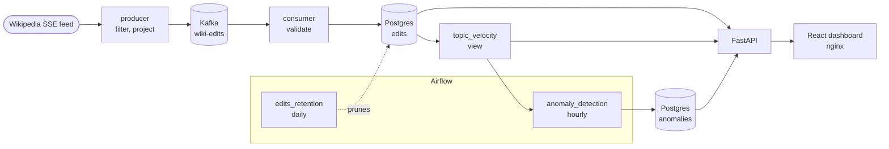

# wiki-pulse

Streams Wikipedia's live edit feed through Kafka into Postgres, tracks edit velocity per page, and flags the pages where something seems to be happening.

Spikes in edit activity often precede news coverage, a Wikipedia page being edited by several people within the same hour usually means something happened. This pipeline captures that signal as it forms.



## Running it

Requires Docker and Python 3 (only to generate two secrets).

```bash
git clone https://github.com/designed7000/wiki-pulse.git
cd wiki-pulse
cp .env.example .env
python3 -c "import base64, os; print('FERNET_KEY=' + base64.urlsafe_b64encode(os.urandom(32)).decode())" >> .env
python3 -c "import secrets; print('AIRFLOW__API_AUTH__JWT_SECRET=' + secrets.token_hex(32))" >> .env
docker compose up -d
```

`.env` holds every password and the two generated secrets, and is gitignored. Nothing secret
lives in `docker-compose.yml`, and Compose refuses to start if a value is missing rather than
falling back to a default. `.env.example` documents each one.

That brings up:
- Kafka and Postgres
- `init` — creates the `wiki-edits` topic, then exits
- `producer` and `consumer` — the pipeline itself
- Airflow — runs the two scheduled DAGs, with its own metadata database
- `api` and `dashboard` — a read-only HTTP API and the React UI on top of it

| | |
|---|---|
| Dashboard | http://localhost:3000 |
| API docs | http://localhost:8000/docs |
| Airflow | http://localhost:8082, login from `.env` |
| kafka-ui | http://localhost:8080, topics and consumer lag |
| Adminer | http://localhost:8081, `PostgreSQL / db / wiki / <POSTGRES_PASSWORD> / wikipulse` |

DAGs start paused. Unpause `anomaly_detection` and `edits_retention` in the Airflow UI, or:

```bash
docker compose exec airflow-scheduler airflow dags unpause anomaly_detection
docker compose exec airflow-scheduler airflow dags unpause edits_retention
```

```bash
docker compose exec db psql -U wiki -d wikipulse -c "SELECT count(*) FROM edits;"
```
Within a few seconds rows start landing...

Query for the pages being edited most heavily right now on Wikipedia:

```sql
SELECT * FROM topic_velocity ORDER BY edit_count DESC LIMIT 10;
```

```
 title                          | bucket           | edit_count | bytes_delta_sum | distinct_users
--------------------------------+------------------+------------+-----------------+----------------
 Genus                          | 2026-08-01 13:00 |          3 |             -19 |              3
 A Matter of Time Tour          | 2026-08-01 14:00 |          3 |              10 |              2
 Siege of Seringapatam          | 2026-08-01 13:00 |          4 |               1 |              1
```

On the dashboard, the pulse and the most active pages fill in within a minute or two. The flagged
list stays empty until the hourly detection run has enough edits to work with.

## What each piece does

**producer** —> holds one long-lived connection to Wikimedia's SSE endpoint.
Filters to:
  - English Wikipedia main-namespace 
  - non-bot edits

After that, it publishes each one to `wiki-edits` keyed by page title. 

**consumer**: 
1. reads the topic, 
2. validates each record
3. writes into `edits` 

Finally, it commits its Kafka offset only after the row is durably in Postgres.

**edits** —> one row per edit. 

`event_id` is the primary key, which is what makes replayed messages harmless.

**topic_velocity**: This is a view, not a table. 

Groups edits by page and hourly bucket, returning the following:
- edit count
- net byte change
- distinct editor count.

**anomaly_detection**: an Airflow DAG, hourly.
1. reads the edit count of every bucket in the last 24 hours
2. takes the 99.5th percentile as the threshold
3. flags the buckets above it that also have at least two distinct editors

**anomalies** —> one row per flagged page and hour.

Each row keeps the threshold, percentile, lookback and minimum editors that produced it. All four
are tunable, so an old flag can't be read without them. `(title, bucket)` is the primary key,
which makes re-running the DAG harmless.

**edits_retention**: an Airflow DAG, daily.

Deletes edits older than 15 days, in batches of 10,000 with a commit per batch, so a backlog never
holds one long transaction. At roughly 35 MB a day including indexes, that keeps `edits` at about
half a gigabyte. `anomalies` is not pruned, the finding outlives the raw edits.

**api** —> a read-only FastAPI service over the output: `/velocity`, `/anomalies` and `/timeline`.

The dashboard never talks to Postgres, and nothing downstream depends on the table layout.

**dashboard** —> React, served by nginx, which also proxies `/api` so the browser stays same-origin.

Shows edit volume per minute, the flagged pages and the most active pages, refreshed every 15 seconds.

## Design decisions

The main ones are below. The full reasoning, including the smaller choices, is in
[docs/DESIGN.md](docs/DESIGN.md).

**Kafka is overkill here** 
55 edits/min fits in one script writing straight to
Postgres. 

The reason I chose it is to have a buffer: kill the consumer, restart it, and nothing is lost.

**Velocity is a view, not a table** 
A counter would double count on replay. A view can't drift
from what it's derived from.

**Buckets are hourly, not per-minute** 
The view started with one-minute buckets. Across the whole dataset that produced zero buckets
with more than one editor, while 378 page-hours had several. People do converge on a page, just
not inside the same 60 seconds. Switching to hourly surfaced real events straight away: a
breaking news story, the US Open, the "Deaths in 2026" list. Going wider would catch more and
mean less. 15 edits in an hour is a signal, 15 across six hours is one edit every 24 minutes.

**Postgres commits before Kafka** 
Crash in between and the message comes back, which `ON CONFLICT DO NOTHING` swallows. Reverse the order and the row is gone. I decided we can afford duplicates but not gaps.

**Bad records and bad databases are handled differently** 
A malformed record fails the same way forever, so it's logged and dropped. So is a row Postgres
rejects outright (constraint violation, bad type). A database that is down is temporary: the
consumer rewinds to the failed message and retries with backoff, and after five attempts it exits
so Docker restarts it from the last committed offset. Treat them alike and you either lose data
or block the partition.

The rewind is what prevents a gap. Offsets are committed "up to and including", so skipping a
failed message and committing the next one would lose the failed one for good.

**The threshold is a global percentile, not a per-page baseline** 
Comparing each page against its own history was the plan. Most pages are edited once and never
again, so there is no history to compare against and nothing would ever be flagged.

**A flag needs at least two editors** 
The first live dashboard showed twelve flagged rows, every one with a single editor. Edit count
alone can't tell one person doing maintenance from several people converging on a page.

**Airflow runs the scheduled work, not the services** 
A DAG run has a beginning, an end and a success state. A long-lived SSE connection has none of
those, so the producer and consumer stay plain Compose services.

## Known limitations

**The topic has one partition**, so only one consumer can work it. Keying by title means adding
partitions later is safe, since per-page ordering survives. The topic would need recreating
though. 

**Single broker, no replication.** Appropriate for local development, not for anything else. For better safety and fault tolerance, more of them would be needed with replication.

**Buckets are fixed, not rolling.** Two editors at 14:59 and 15:01 land in different buckets and
neither is flagged. A rolling window would fix it.

**The 24-hour window lives in the view.** The anomaly DAG can't look back further than that, and
can't be backfilled for a past day.

**Flags say that something happened, not what.** A flagged page still needs a human to open it.

**Not yet checked against a real news cycle.** Whether multi-editor hours are a good signal needs
days of data across a period when news actually breaks.

**Schema changes are applied by hand.** `schema.sql` only runs on an empty volume. Alembic is the
answer if this grows.

**Local development only.** Example passwords, ports bound to localhost, no TLS.

## Development

Services run from the host during development, against the containerised infrastructure:

```bash
docker compose up -d kafka db     #infrastructure only
uv sync
python -m wiki_pulse.producer
```

```bash
uv run pytest
```

The dashboard has its own dev server, which proxies `/api` to the API on `localhost:8000`:

```bash
cd dashboard
npm install
npm run dev
```

See `instructions.md` for the full command reference. 

Unit tests cover parsing, filtering, validation, column mapping and the percentile calculation, all pure functions. The consumer loop and the API are tested against small hand-written fakes passed in as arguments. No broker, database or patching is required, and the cases are built to simulate real-world ones.

## What's next

**Labels for flagged pages.** An LLM pass that says what happened (breaking news, edit war,
vandalism). It only ever sees the flagged handful, never the stream, and it stays off the critical
path: if the model is slow, wrong or unavailable, the pipeline is unaffected.

**A live demo.** The same Compose file on a single small VM, with only the dashboard exposed.
Managed Kafka and Airflow would cost far more than 55 edits a minute can justify.

**Tuning the window.** Something between a minute and an hour is probably better, and a rolling
window would remove the bucket-boundary problem.

## License

MIT, see [LICENSE](LICENSE).
