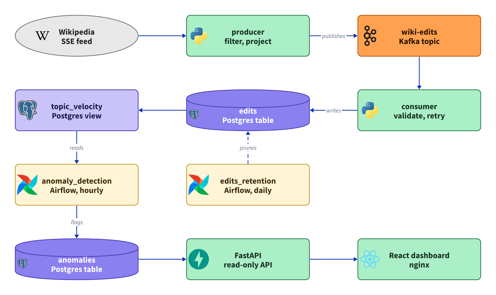

# wiki-pulse

[](https://github.com/designed7000/wiki-pulse/actions/workflows/ci.yml)
[](https://kafka.apache.org)
[](https://www.postgresql.org)
[](https://airflow.apache.org)
[](https://fastapi.tiangolo.com)
[](https://react.dev)
[](https://www.docker.com)

**Watches every edit to English Wikipedia as it happens, and flags the pages where several people
suddenly start editing at once.**

Spikes in edit activity often precede news coverage: a page edited by several people within the
same hour usually means something happened. This pipeline catches that signal as it forms.

<a href="docs/architecture-light.png">
  <picture>
    <source media="(prefers-color-scheme: dark)" srcset="docs/architecture-dark.png">
    
  </picture>
</a>

## Highlights

- **Tuned on real data.** Per-minute buckets found zero pages with more than one editor. Hourly
  buckets found 378, and surfaced real events straight away: the US Open, the "Deaths in 2026" list.
- **No gaps.** Postgres commits before Kafka, and a failed write rewinds instead of skipping.
  Duplicates are cheap; gaps are not.
- **Replays are harmless.** Wikimedia's event id is the primary key, and velocity is a view rather
  than a counter, so nothing can be counted twice.
- **Two editors or it doesn't count.** The first dashboard flagged twelve pages, every one with a
  single editor behind it.
- **Kafka is overkill, on purpose.** 55 edits a minute fits in one script. Kafka buys a buffer: kill
  the consumer, restart it, and nothing is lost.

The reasoning behind these, and the smaller choices, is in [docs/DESIGN.md](docs/DESIGN.md).

## How it works

A **producer** holds one connection to Wikimedia's live feed, keeps non-bot edits to English
Wikipedia articles, and publishes them to Kafka. A **consumer** validates each one and writes it to
Postgres, where a view counts edits and distinct editors per page per hour.

Every hour, an **Airflow** DAG flags the page-hours above the 99.5th percentile that also have at
least two editors. A daily one prunes edits older than 15 days. A read-only **FastAPI** service
feeds the **React** dashboard.

<details>
<summary>Each component in detail</summary>

**producer**: holds one long-lived connection to Wikimedia's SSE endpoint and keeps English
Wikipedia, main-namespace, non-bot edits. Publishes each to `wiki-edits`, keyed by page title.

**consumer**: reads the topic, validates each record and writes it into `edits`. It commits its
Kafka offset only after the row is durably in Postgres.

**edits**: one row per edit. `event_id` is the primary key, which makes replayed messages harmless.

**topic_velocity**: a view, not a table. Groups edits by page and hourly bucket, returning the edit
count, net byte change and distinct editor count.

**anomaly_detection**: an Airflow DAG, hourly. Reads the edit count of every bucket in the last 24
hours, takes the 99.5th percentile as the threshold, and flags the buckets above it that also have
at least two distinct editors.

**anomalies**: one row per flagged page and hour. Each row keeps the threshold, percentile,
lookback and minimum editors that produced it, since all four are tunable and an old flag can't be
read without them. `(title, bucket)` is the primary key, which makes re-running the DAG harmless.

**edits_retention**: an Airflow DAG, daily. Deletes edits older than 15 days, in batches of 10,000
with a commit per batch, so a backlog never holds one long transaction. At roughly 35 MB a day
including indexes, that keeps `edits` at about half a gigabyte. `anomalies` is not pruned: the
finding outlives the raw edits.

**api**: a read-only FastAPI service with `/velocity`, `/anomalies` and `/timeline`. The dashboard
never talks to Postgres, and nothing downstream depends on the table layout.

**dashboard**: React, served by nginx, which also proxies `/api` so the browser stays same-origin.
Shows edit volume per minute, the flagged pages and the most active pages, refreshed every 15
seconds.

</details>

## Run it

Needs Docker, plus Python 3 to generate two secrets.

```bash
git clone https://github.com/designed7000/wiki-pulse.git
cd wiki-pulse
cp .env.example .env
python3 -c "import base64, os; print('FERNET_KEY=' + base64.urlsafe_b64encode(os.urandom(32)).decode())" >> .env
python3 -c "import secrets; print('AIRFLOW__API_AUTH__JWT_SECRET=' + secrets.token_hex(32))" >> .env
docker compose up -d
```

Then open the dashboard at http://localhost:3000. Edits appear within a minute or two.

<details>
<summary>What starts, where to look, and querying it directly</summary>

`.env` holds every password and the two generated secrets, and is gitignored. Nothing secret lives
in `docker-compose.yml`, and Compose refuses to start if a value is missing rather than falling
back to a default. `.env.example` documents each one.

That brings up Kafka and Postgres; `init`, which creates the `wiki-edits` topic and exits; the
`producer` and `consumer`; Airflow with its own metadata database; and the `api` and `dashboard`.

| | |
|---|---|
| Dashboard | http://localhost:3000 |
| API docs | http://localhost:8000/docs |
| Airflow | http://localhost:8082, login from `.env` |
| kafka-ui | http://localhost:8080, topics and consumer lag |
| Adminer | http://localhost:8081, `PostgreSQL / db / wiki / <POSTGRES_PASSWORD> / wikipulse` |

DAGs start paused. Unpause `anomaly_detection` and `edits_retention` in the Airflow UI, or:

```bash
docker compose exec airflow-scheduler airflow dags unpause anomaly_detection
docker compose exec airflow-scheduler airflow dags unpause edits_retention
```

The flagged list stays empty until the hourly detection run has enough edits to work with.

Rows start landing in Postgres within seconds:

```bash
docker compose exec db psql -U wiki -d wikipulse -c "SELECT count(*) FROM edits;"
```

The pages being edited most heavily right now:

```sql
SELECT * FROM topic_velocity ORDER BY edit_count DESC LIMIT 10;
```

```
 title                          | bucket           | edit_count | bytes_delta_sum | distinct_users
--------------------------------+------------------+------------+-----------------+----------------
 Genus                          | 2026-08-01 13:00 |          3 |             -19 |              3
 A Matter of Time Tour          | 2026-08-01 14:00 |          3 |              10 |              2
 Siege of Seringapatam          | 2026-08-01 13:00 |          4 |               1 |              1
```

</details>

## Limitations

- **Flags say that something happened, not what.** A human still has to open the page.
- **Not yet tested against a real news cycle.** That needs days of data across a period when news
  actually breaks.
- **Buckets are fixed, not rolling.** Editors at 14:59 and 15:01 land in different hours.
- **Built for one machine.** One Kafka broker and partition, example passwords, no TLS.

The full list is in [docs/DESIGN.md](docs/DESIGN.md#known-limitations).

## What's next

- **Labels for flagged pages.** An LLM pass that says what happened (breaking news, edit war,
  vandalism). It only sees the flagged handful, never the stream, so if it is slow, wrong or down,
  the pipeline is unaffected.
- **A live demo.** The same Compose file on one small VM, with only the dashboard exposed. Managed
  Kafka and Airflow would cost far more than 55 edits a minute can justify.
- **Tuning the window.** Something between a minute and an hour is probably better, and a rolling
  window would remove the bucket-boundary problem.

<details>
<summary>Development</summary>

Services run from the host during development, against the containerised infrastructure:

```bash
docker compose up -d kafka db     # infrastructure only
uv sync
python -m wiki_pulse.producer
```

```bash
uv run pytest
```

The dashboard has its own dev server, which proxies `/api` to the API on `localhost:8000`:

```bash
cd dashboard
npm install
npm run dev
```

Unit tests cover parsing, filtering, validation, column mapping and the percentile calculation, all
pure functions. The consumer loop and the API are tested against small hand-written fakes passed in
as arguments. No broker, database or patching is required, and the cases are built to simulate
real-world ones.

See [instructions.md](instructions.md) for the full command reference.

</details>

## License

MIT, see [LICENSE](LICENSE).
