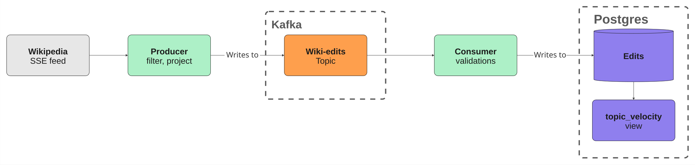

# wiki-pulse

Streams Wikipedia's live edit feed through Kafka into Postgres, and tracks edit velocity per
page.

Spikes in edit activity often precede news coverage, a Wikipedia page being edited by several people within the same minute usually means something happened. This pipeline captures that signal as it forms.



## Running it

Requires Docker.

```bash
git clone https://github.com/designed7000/wiki-pulse.git
cd wiki-pulse
docker compose up -d
```

That brings up:
- Kafka and Postgres
- `bootstrap` — creates the `wiki-edits` topic, then exits
- `producer` and `consumer` — the pipeline itself

```bash
docker compose exec db psql -U wiki -d wikipulse -c "SELECT count(*) FROM edits;"
```
Within a few seconds rows start landing...

Query for the pages being edited most heavily right now on Wikipedia:

```sql
SELECT * FROM topic_velocity ORDER BY edit_count DESC LIMIT 10;
```

```
 title                          | bucket           | edit_count | bytes_delta_sum | distinct_users
--------------------------------+------------------+------------+-----------------+----------------
 Genus                          | 2026-08-01 13:33 |          3 |             -19 |              3
 A Matter of Time Tour          | 2026-08-01 14:00 |          3 |              10 |              2
 Siege of Seringapatam          | 2026-08-01 13:04 |          4 |               1 |              1
```

Two web UIs are included for inspection: kafka-ui on `:8080` for topics and consumer lag,
Adminer on `:8081` for the database (`PostgreSQL / db / wiki / wiki / wikipulse`).

## What each piece does

**producer** —> holds one long-lived connection to Wikimedia's SSE endpoint, filters to English
Wikipedia main-namespace non-bot edits, and publishes each one to `wiki-edits` keyed by page
title. The only component touching the outside world.

**consumer** —> reads the topic, validates each record, and writes into `edits`. Commits its Kafka
offset only after the row is durably in Postgres.

**edits** —> one row per edit. `event_id` is the primary key, which is what makes replayed
messages harmless.

**topic_velocity** —> a view, not a table. Groups edits by page and one-minute bucket, returning
edit count, net byte change, and distinct editor count.

## Design decisions

## Design decisions

**Kafka is overkill here, deliberately** 
55 edits/min fits in one script writing straight to
Postgres. What Kafka buys is a buffer: kill the consumer, restart it, and nothing is lost.

**Velocity is a view, not a table** 
A counter would double count on replay. A view can't drift
from what it's derived from.

**Postgres commits before Kafka** 
Crash in between and the message comes back, which
`ON CONFLICT DO NOTHING` swallows. Reverse the order and the row is gone. I decided we can afford duplicates but not gaps.

**Bad records and bad databases are handled differently** 
A malformed record fails the same way
forever, so it's logged and dropped. A database error is temporary, so the message is left
uncommitted and retried. Treat them alike and you either lose data or block the partition.

**The logic is pure functions; the services are loops around them.** That's why the tests need
neither a broker nor a database.

## Known limitations

**`edits` grows without bound**, at roughly 35 MB/day including indexes. There is no retention
policy yet, the view's 24-hour window bounds what is read, not what is kept.

**The topic has one partition**, so only one consumer can work it. Keying by title means adding
partitions later is safe, since per-page ordering survives. The topic would need recreating
though.

**No alerting.** Velocity is queryable but nothing surfaces a spike on its own.

**Single broker, no replication.** Appropriate for local development, not for anything else.

## Development

Services run from the host during development, against the containerised infrastructure:

```bash
docker compose up -d kafka db     # infrastructure only
uv sync
python -m wiki_pulse.producer
```

```bash
uv run pytest
```

See `instructions.md` for the full command reference.

Unit tests cover parsing, filtering, validation, and column mapping all pure functions, so no broker, database, or mocking is required.

## What's next

**Phase 2** 
Use topic_velocity to track down signals. Right now, a spike is visible only if someone runs the query from above.

- Airflow on the stack, orchestrating everything scheduled
- Anomaly detection comparing each page against its own baseline, not a fixed threshold. Three
  edits a minute means nothing on a busy page and a lot on a quiet one
- A retention policy for `edits` db, which currently grows forever
- An LLM pass over flagged spikes to label what happened: breaking news, edit war, vandalism.
  It only ever sees the flagged handful, never the stream

**Phase 3** deploys the stack to AWS.